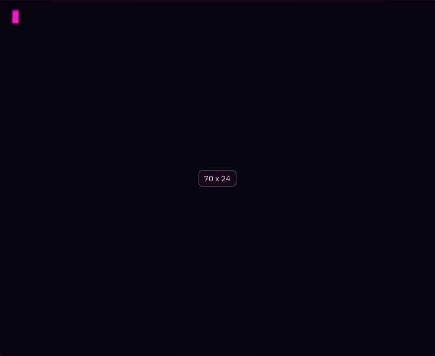
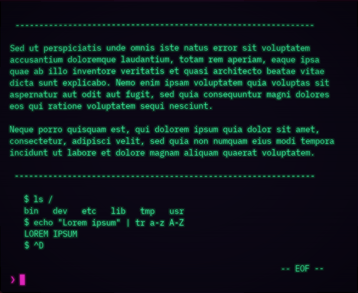

<!-- LOGO -->
<h1>
<p align="center">
  
  <br>Ghostty
</h1>
  <p align="center">
    Fast, native, feature-rich terminal emulator pushing modern features.
    <br />
    A native GUI or embeddable library via <code>libghostty</code>.
    <br />
    <a href="#about-this-fork">About</a>
    ·
    <a href="#download">Download</a>
    ·
    <a href="#build-and-install-on-linux">Linux</a>
    ·
    <a href="#build-and-install-on-macos">macOS</a>
    ·
    <a href="https://ghostty.org/docs">Documentation</a>
  </p>
</p>

## About this fork

This is a personal fork of [Ghostty](https://github.com/ghostty-org/ghostty)
that adds one new feature: **`output-delay`**, a typewriter-style effect for
terminal output.

> [!NOTE]
> This branch is **not intended for upstream**. It will not be submitted as a
> pull request to `ghostty-org/ghostty`; it lives only in this fork. See the
> upstream discussion:
> [ghostty-org/ghostty#15310](https://github.com/ghostty-org/ghostty/discussions/15310).

### `output-delay`

Set a delay between printed characters and output appears one character at a
time, like the slow serial-line terminals of the 1970s and 1980s (IBM 3270,
DEC VT-style teletypes), instead of all at once.

```ini
# ~/.config/ghostty/config.ghostty
output-delay = 4ms
```

<p align="center">
  
</p>

<details>
<summary>Screenshot</summary>
<p align="center">
  
</p>
</details>

The recording `cat`s [`extra/lorem-ipsum.txt`](extra/lorem-ipsum.txt) with
the Neon Phosphor config below. It was made in a VirtualBox VM with software
rendering, so it runs a little slower than the 4ms setting would on real
hardware.

- **Off by default** (`0`). Any duration works, e.g. `5ms` or `30ms`.
- **Only printable characters are delayed.** Escape sequences and control
  characters go through immediately, so colors and cursor movement stay fast.
- **Full-screen apps are never slowed down.** Anything on the alternate
  screen (vim, less, htop, ...) runs at full speed.
- **Ctrl+C, Ctrl+\ or Ctrl+Z throws away queued output** instead of dumping
  it on screen. The delay itself stays on for whatever comes next.
- **Changes apply live.** Edit the value and reload the config
  (Ctrl+Shift+, on Linux) without restarting.

## Download

The feature lives on the
[`feature/output-delay`](https://github.com/otisranson/ghostty/tree/feature/output-delay) branch, so clone that branch
specifically (the fork's `main` is plain upstream Ghostty):

```sh
git clone -b feature/output-delay https://github.com/otisranson/ghostty.git
cd ghostty
```

To update later, run `git pull` inside that folder and rebuild/reinstall
using the steps below.

There are no prebuilt binaries. You build it yourself with
[Zig](https://ziglang.org/download/). It needs **Zig 0.17.1** (the version in
`build.zig.zon`). Distro and Homebrew Zig packages are often a
different version, so download 0.17.1 straight from ziglang.org if in doubt:

```sh
zig version   # must print 0.17.1
```

## Build and install on Linux

**1. Install the build dependencies.** On Debian or Ubuntu:

```sh
sudo apt install build-essential blueprint-compiler pkg-config \
  libgtk-4-dev libadwaita-1-dev libgtk4-layer-shell-dev
```

On Fedora: `sudo dnf install gcc blueprint-compiler gtk4-devel libadwaita-devel gtk4-layer-shell-devel`.
On Arch: `sudo pacman -S base-devel blueprint-compiler gtk4 libadwaita gtk4-layer-shell`.
`blueprint-compiler` must be 0.16.0 or newer.

**2. Build and install** into `~/.local` (no root needed):

```sh
zig build -p "$HOME/.local" -Doptimize=ReleaseFast \
  -Dinstalled-exe-path="$HOME/.local/bin/ghostty"
```

This installs the `ghostty` binary to `~/.local/bin`, plus the desktop entry,
icons, themes, shell integration and man pages under `~/.local/share`, so
Ghostty shows up in your application menu. `-Dinstalled-exe-path` makes the
desktop entry and D-Bus/systemd service point at the right binary.

Make sure `~/.local/bin` is on your `PATH`, then check it worked:

```sh
ghostty +version
```

To install system-wide instead, use `sudo zig build -p /usr/local -Doptimize=ReleaseFast`.

**Running in a VM?** Ghostty needs OpenGL 4.3. Some virtual GPUs (VirtualBox,
VMware) only offer 4.1, and Ghostty fails with `failed to create EGL context`.
Force Mesa's software renderer by adding this to `~/.xsessionrc` (or your
shell profile) and logging back in:

```sh
export LIBGL_ALWAYS_SOFTWARE=1
```

**Uninstall:** `zig build uninstall -p "$HOME/.local"` from the repo folder.

## Build and install on macOS

**1. Install the toolchain.** You need:

- **Xcode 26** with the macOS 26 SDK and the Metal Toolchain (install it from
  the App Store; it builds fine on macOS 15 too). Then select it:

  ```sh
  sudo xcode-select --switch /Applications/Xcode.app
  ```

- **Zig 0.17.1**: download `zig-aarch64-macos-0.17.1.tar.xz` (Apple Silicon)
  or `zig-x86_64-macos-0.17.1.tar.xz` (Intel) from
  [ziglang.org](https://ziglang.org/download/), unpack it and put it on your
  `PATH`.

**2. Build the app:**

```sh
zig build -Doptimize=ReleaseFast
```

This builds `Ghostty.app` at `macos/build/ReleaseLocal/Ghostty.app`.

**3. Install it** by copying it into Applications:

```sh
rm -rf /Applications/Ghostty.app
cp -R macos/build/ReleaseLocal/Ghostty.app /Applications/
```

This **replaces** any official Ghostty you already have installed, since the
fork uses the same app name and bundle ID. Quit Ghostty before copying.
The official app's auto-updater would swap the fork back out for upstream
Ghostty, so turn it off in your config:

```ini
auto-update = off
```

To use the `ghostty` CLI from a terminal, it's inside the bundle at
`/Applications/Ghostty.app/Contents/MacOS/ghostty`.

## Turn it on

Add the setting to your config file, `~/.config/ghostty/config.ghostty`
(on macOS you can also open it with Cmd+,):

```ini
output-delay = 4ms
```

Reload the config (Ctrl+Shift+, on Linux, Cmd+Shift+, on macOS) or open a new
window, then `cat` something long, such as `extra/lorem-ipsum.txt`.

## My config: Neon Phosphor

The theme in the demo is my own config, in
[`extra/neon-phosphor/`](extra/neon-phosphor). It's cyberpunk neon on a
1970s Bell Labs-style screen: phosphor-green text on a violet-black
background, magenta block cursor, IBM Plex Mono, and a CRT shader with
screen curvature, glow, scanlines and a vignette. The window is 85% opaque,
with a slim title bar that merges the tabs and window controls and keeps
only the new-tab and minimize/maximize/close buttons (GTK only, via
`ghostty.css`). The title bar uses the same opacity as the terminal, so if
you change `background-opacity`, change the alpha in `ghostty.css` to match.

To use it, copy these files into your Ghostty config folder:

```sh
mkdir -p ~/.config/ghostty/shaders
cp extra/neon-phosphor/config.ghostty extra/neon-phosphor/ghostty.css ~/.config/ghostty/
cp extra/neon-phosphor/shaders/crt.glsl ~/.config/ghostty/shaders/
```

It expects [IBM Plex Mono](https://github.com/IBM/plex) to be installed and
falls back to DejaVu Sans Mono without it. The `output-delay` line only
works with this fork; upstream Ghostty will report it as an unknown option.

### Full-colour tray icons

[`extra/neon-phosphor/tray-icons/build.py`](extra/neon-phosphor/tray-icons/build.py)
builds a small icon theme, `NeonPhosphor-Icons`, that swaps XFCE's flat
one-colour tray icons (volume, notifications, battery, network) for
full-colour [Papirus](https://github.com/PapirusDevelopmentTeam/papirus-icon-theme)
pictures. Muted, disconnected and new-notification states get small badges.
The tray plugins ask for "-symbolic" icon names, which GTK paints in one
colour, so the script answers those names with PNGs, which GTK leaves alone.
Everything else is inherited from Papirus-Dark.

```sh
python3 extra/neon-phosphor/tray-icons/build.py   # needs Papirus-Dark in ~/.local/share/icons
xfconf-query -c xsettings -p /Net/IconThemeName -s NeonPhosphor-Icons
xfconf-query -c xfce4-panel -p /plugins/plugin-5/symbolic-icons -s false   # your systray plugin id may differ
```

### Ghostty tray icon

[`extra/neon-phosphor/ghostty-tray/`](extra/neon-phosphor/ghostty-tray) is a
small helper that keeps a Ghostty icon in the system tray. Minimized Ghostty
windows leave the taskbar and go to the tray. Left-click the icon to restore
the latest one (or focus Ghostty, or launch it), and right-click for a list
of hidden windows and "New window". It watches windows from outside
Ghostty, so it works with any build. X11 only; it needs the libwnck
introspection data (`gir1.2-wnck-3.0` on Debian/Ubuntu).

```sh
sudo apt install gir1.2-wnck-3.0
install -m 755 extra/neon-phosphor/ghostty-tray/ghostty-tray ~/.local/bin/
cp extra/neon-phosphor/ghostty-tray/ghostty-tray.desktop ~/.config/autostart/
```
